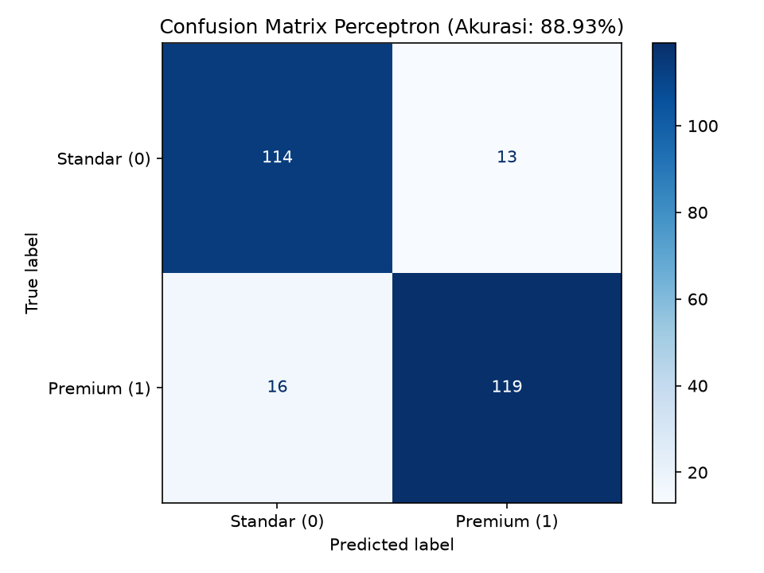

# Klasifikasi Kualitas Kopi Arabika (Single-Layer Perceptron)

Aplikasi web interaktif berbasis **Streamlit** untuk mengklasifikasikan kualitas biji kopi Arabika ke dalam kategori **Premium (Kelas 1)** atau **Standar (Kelas 0)** menggunakan algoritma **Single-Layer Perceptron**.

## Fitur Utama
- **Preprocessing & Feature Selection:** Pembersihan data (*outlier* & *missing values*) serta seleksi 6 parameter cita rasa kopi.
- **Model Single-Layer Perceptron:** Klasifikasi biner (*Binary Classification*) menggunakan `scikit-learn` dengan normalisasi `StandardScaler`.
- **Aplikasi Web Interaktif:** Input 6 skor cita rasa secara presisi (skala `0.00 – 10.00`), menampilkan hasil prediksi kelas beserta rincian perhitungan **Net Input ($v$)** dan aturan **Step Function**.

## Dataset & Metodologi
Dataset bersumber dari [Coffee Quality Database (CQI) — Kaggle](https://www.kaggle.com/datasets/volpatto/coffee-quality-database-from-cqi) menggunakan file `arabica_data_cleaned.csv`.

- **Jumlah Data Bersih:** 1.310 baris (setelah menghapus 1 baris *outlier* bernilai `0`).
- **Fitur Input ($x$):** `Aroma`, `Flavor`, `Aftertaste`, `Acidity`, `Body`, dan `Balance`.
- **Target / Label ($y$):** Dibagi menggunakan *Median Split* dari kolom `Total.Cup.Points` (batas **82,5**) agar data seimbang (*Balanced Dataset*):
  - **Kelas 1 (Premium):** $\ge 82,5$ (674 data / 51,5%)
  - **Kelas 0 (Standar):** $< 82,5$ (636 data / 48,5%)
- **Pembagian Data:** *Stratified Train-Test Split* **80:20** (1.048 data latih, 262 data uji).

## Hasil Evaluasi Model
Pengujian pada 262 data uji menghasilkan performa sebagai berikut:

| Metrik | Standar (0) | Premium (1) | Rata-rata (Weighted) |
| :--- | :---: | :---: | :---: |
| **Precision** | 0.88 | 0.90 | 0.89 |
| **Recall** | 0.90 | 0.88 | 0.89 |
| **F1-Score** | 0.89 | 0.89 | 0.89 |
| **Akurasi Total** | — | — | **88,93%** |



## Struktur Proyek
```text
├── models/
│   ├── perceptron_model.pkl   # Model Perceptron terlatih
│   └── scaler.pkl             # Objek StandardScaler
├── arabica_data_cleaned.csv   # Dataset mentah (CQI)
├── data_arabica_clean.csv     # Dataset bersih hasil preprocessing
├── preprocessing.py           # Script pembersihan & labeling data
├── train-perceptron.py        # Script training, evaluasi & simpan model
├── app.py                     # Aplikasi web Streamlit
└── confusion_matrix.png       # Visualisasi hasil evaluasi
```

## Cara Menjalankan Proyek

1. **Clone repositori ini:**
   ```bash
   git clone [https://github.com/username-kamu/nama-repo-kamu.git](https://github.com/username-kamu/nama-repo-kamu.git)
   cd nama-repo-kamu
   ```

2. **Install library yang dibutuhkan:**
   ```bash
   pip install pandas scikit-learn matplotlib streamlit
   ```

3. **(Opsional) Jalankan ulang preprocessing & training:**
   ```bash
   python preprocessing.py
   python train-perceptron.py
   ```

4. **Jalankan aplikasi web Streamlit:**
   ```bash
   streamlit run app.py
   ```

## Teknologi yang Digunakan
- **Bahasa:** Python
- **Machine Learning & Data:** Pandas, Scikit-learn, Matplotlib
- **Web Interface:** Streamlit
